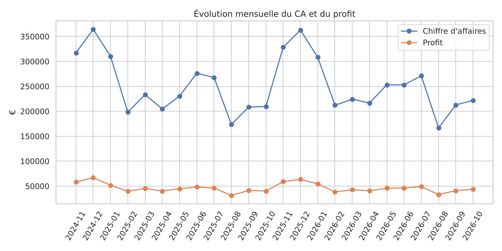
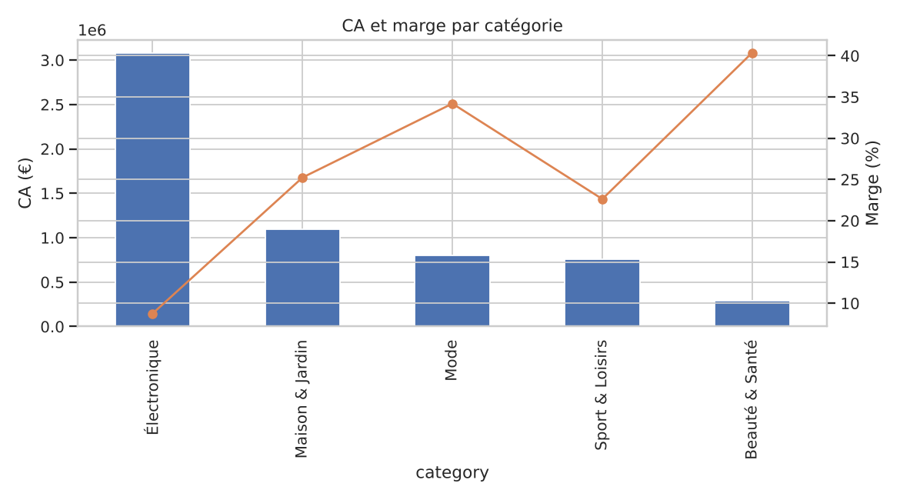
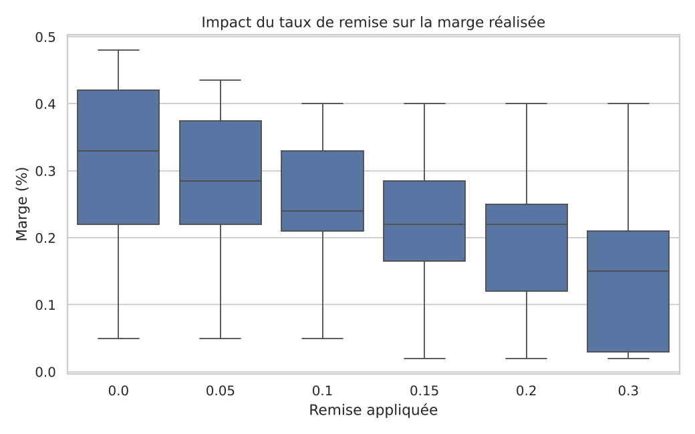
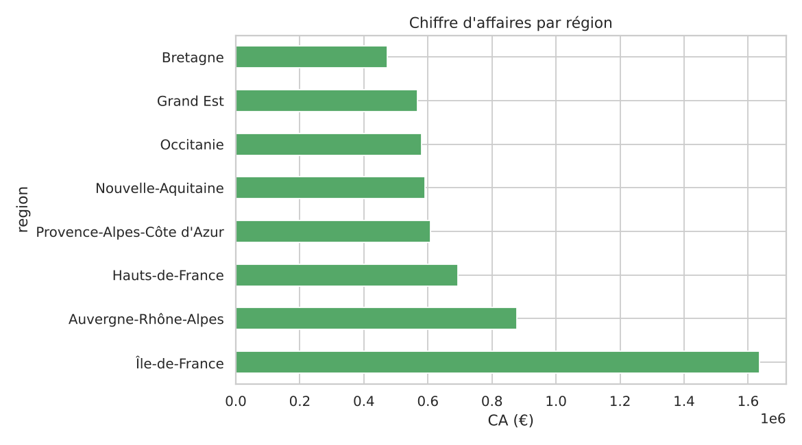
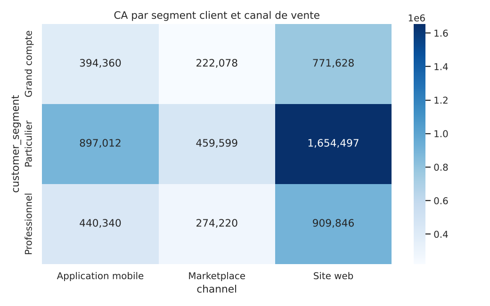

#  Analyse des ventes e-commerce — Leviers de croissance et de rentabilité

**Question métier :** Sur un e-commerçant opérant en France, quels sont les catégories, régions, segments et politiques de remise qui génèrent le plus de chiffre d'affaires — et surtout le plus de **profit** ? Où l'entreprise perd-elle de la marge sans s'en rendre compte ?

> Jeu de données : 22 785 commandes simulées sur 24 mois (nov. 2024 – oct. 2026), construit avec des règles métier réalistes (saisonnalité, remises, segments clients, marges par catégorie) pour servir de cas d'étude portfolio. Généré avec `generate_data.py` — méthodologie documentée plus bas.

---

##  Insights clés

| Constat | Chiffre |
|---|---|
| CA total / Profit total | 6 023 580 € / 1 109 551 € (marge globale **18,4 %**) |
| Panier moyen | 264 € sur 22 785 commandes |
| Catégorie n°1 en CA | **Électronique** (3,08 M€) — mais marge la plus faible du portefeuille (**8,8 %**) |
| Catégorie la plus rentable | **Beauté & Santé** — marge de **40,4 %**, pourtant sous-représentée en CA |
| Effet des remises | Marge moyenne **30,7 %** sans remise vs **17,1 %** avec remise ≥ 20 % |
| Région leader / la plus faible | Île-de-France (1,64 M€) vs Bretagne (472 k€) |
| Saisonnalité | Pic en décembre 2024 (364 k€), creux en août 2026 (167 k€) |

### Lecture business

1. **L'Électronique tire le CA mais plombe la marge.** C'est la catégorie la plus vendue, mais sa marge (8,8 %) est 4 à 5x plus faible que Beauté & Santé ou Mode. Un rééquilibrage du mix produit (cross-sell vers les catégories à forte marge) aurait un effet direct sur la rentabilité sans effort commercial supplémentaire.
2. **Les remises fortes détruisent la marge plus vite qu'elles ne génèrent de volume additionnel.** Au-delà de 20 % de remise, la marge chute de près de 14 points. À creuser : est-ce que le volume gagné compense réellement cette perte de marge unitaire ?
3. **Concentration géographique forte.** L'Île-de-France pèse 3,5x plus que la Bretagne. Avant d'investir en acquisition sur l'ensemble du territoire, prioriser les régions où le potentiel est prouvé mais sous-exploité.
4. **Saisonnalité marquée** (fêtes de fin d'année, soldes) à anticiper côté stock et logistique — et creux estival à combler par des campagnes ciblées plutôt que par des remises agressives qui dégradent encore la marge.

---

##  Visualisations

| | |
|---|---|
|  |  |
|  |  |



---

##  Stack

- **Python** (pandas, numpy) — génération de données et nettoyage
- **Matplotlib / Seaborn** — exploration visuelle
- **SQL-ready** — le CSV est structuré pour être chargé directement dans PostgreSQL ou interrogé en SQL (voir `queries.sql`)
- **Tableau Public** — dashboard interactif à partir du même CSV → *[lien à ajouter une fois le dashboard publié]*

##  Structure du repo

```
ecommerce-sales-analysis/
├── data/
│   └── ventes_ecommerce_2024_2026.csv
├── charts/
│   └── *.png
├── generate_data.py      # génération du dataset (règles métier documentées)
├── analysis.py           # EDA + calcul des insights
├── queries.sql           # requêtes SQL équivalentes pour démontrer la maîtrise SQL
└── README.md
```

##  Reproduire l'analyse

```bash
pip install pandas numpy matplotlib seaborn
python generate_data.py   # génère data/ventes_ecommerce_2024_2026.csv
python analysis.py        # régénère les graphiques dans charts/ et affiche les insights
```


---
*Projet portfolio // données synthétiques construites avec des hypothèses métier réalistes, à des fins de démonstration de compétences en analyse de données (EDA, SQL, visualisation, storytelling data).*
